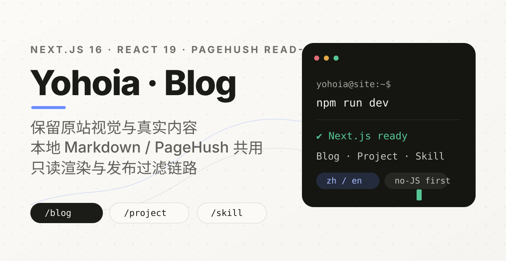
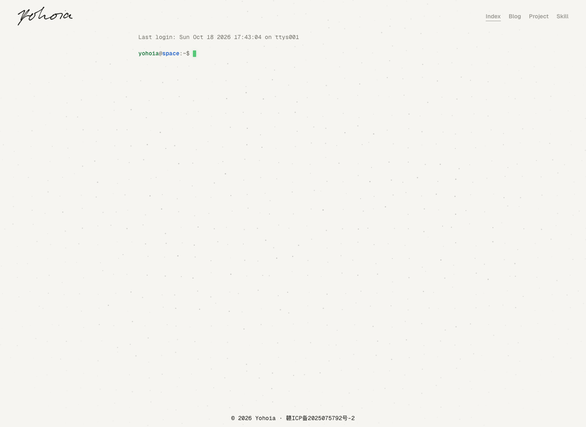
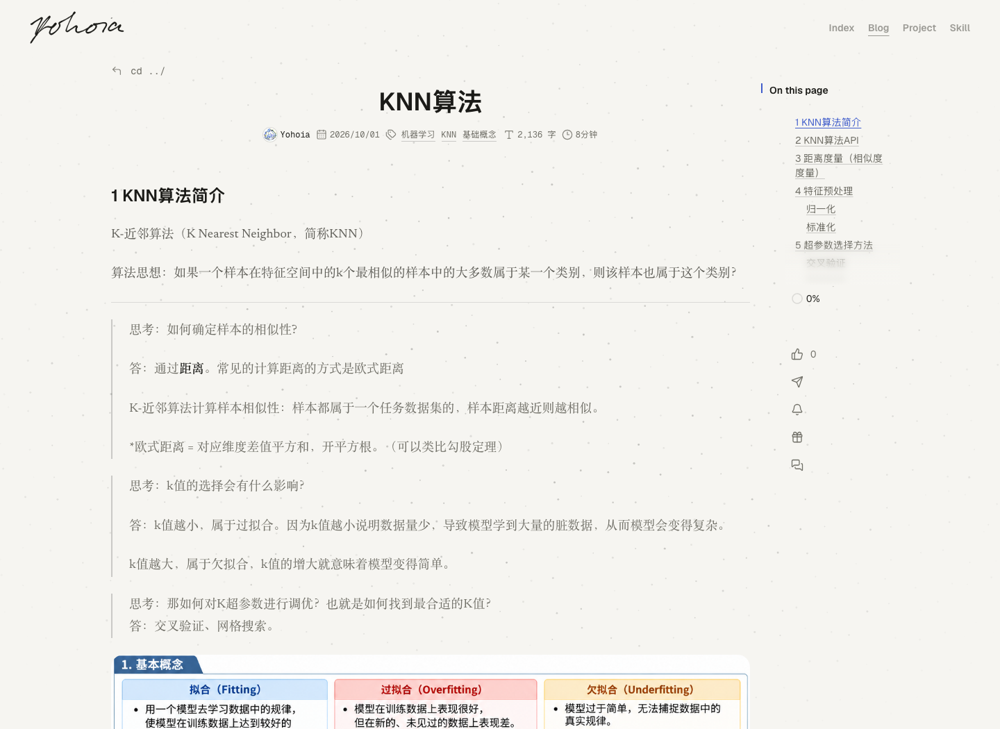
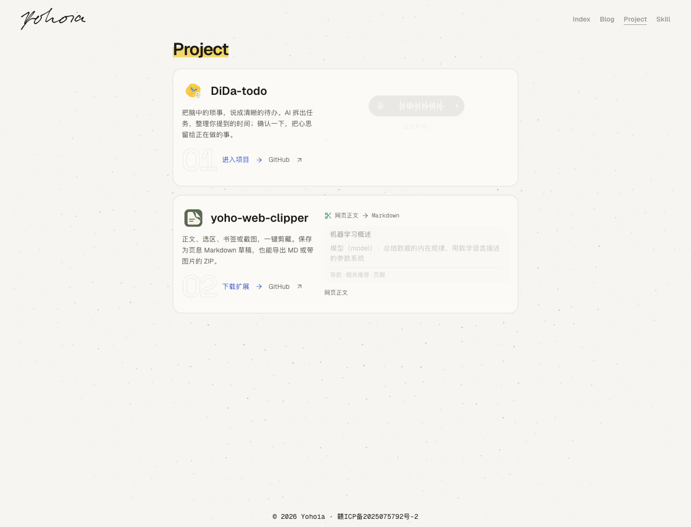
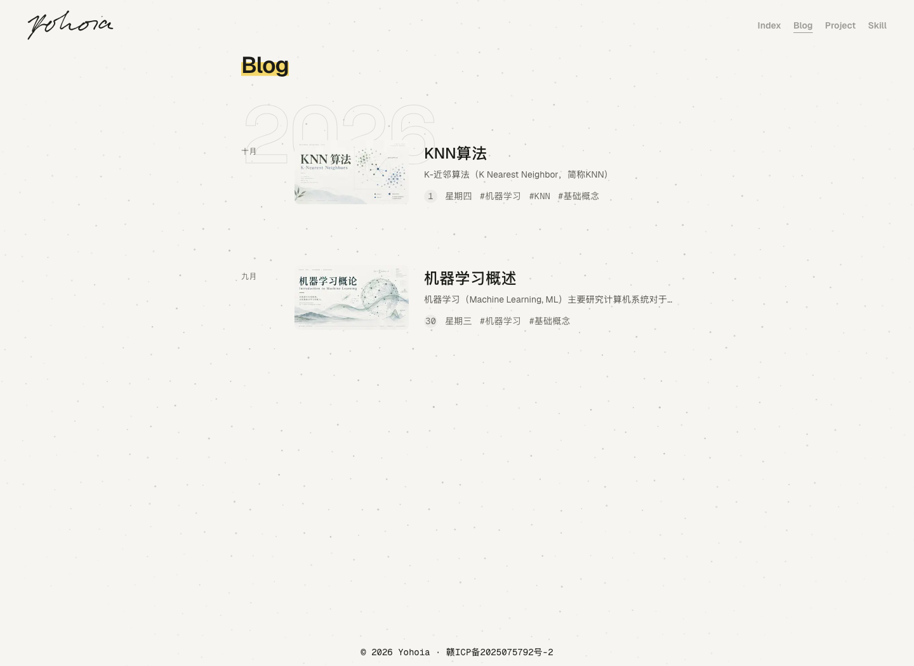
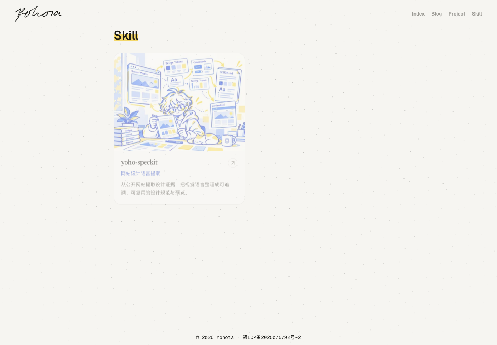
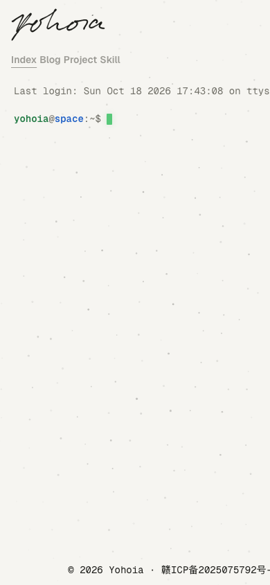
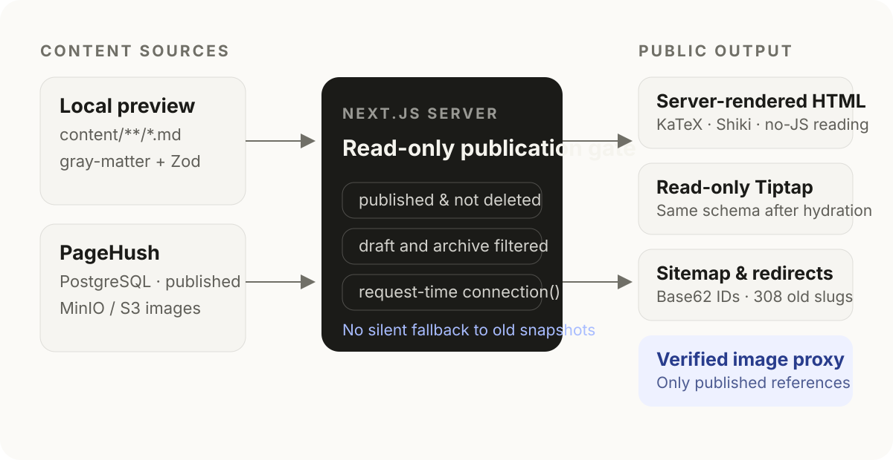

<p align="center">
  
</p>

<p align="center">
  
  
  
  
  
</p>

**Yohoia Blog** 是一个 Next.js 个人站点，包含 Blog、Project 和 Skill 三个栏目。站点内置纸色视觉系统、终端式首页、主题与语言切换、项目演示和真实文章，并支持本地 Markdown 快照或 PageHush 只读 PostgreSQL / MinIO 内容源。

> 当前状态：本地开发与验证完成；尚未初始化 Git 仓库，也尚未执行线上部署。

## 真实页面



| 文章阅读                                                                               | 项目展示                                                                                    |
| -------------------------------------------------------------------------------------- | ------------------------------------------------------------------------------------------- |
|  |  |

| Blog 归档                                                      | Skill 卡片                                                   | 手机布局                                                 |
| -------------------------------------------------------------- | ------------------------------------------------------------ | -------------------------------------------------------- |
|  |  |  |

## 站点能力

- 中英文显式路由：`/`、`/blog`、`/project`、`/skill` 与 `/en/...`
- 透明导航、Logo 动画、有机波点背景、原生光标、主题与语言切换
- 首页终端、像素头像、栏目 ASCII 过渡、Blog 归档、目录与阅读快捷栏
- DiDa 与 PageHush Clipper 的本地项目演示，不连接真实账号
- 根 `/404`、`/500` 的真实 HTTP 状态，以及 `/403`、`/404`、`/500`、`/502` 预览页
- `/projects`、`/skills` 等旧地址 308 跳转到单数路径；未知地址返回自定义 404
- 英文界面复用真实中文文章，不做自动翻译

## 内容与渲染机制

<p align="center">
  
</p>

文章正文使用 Tiptap Simple Editor 的只读派生版。服务端先用 `@tiptap/markdown` 解析 Markdown，再用与 PageHush 相同的扩展 Schema 生成首屏 HTML；浏览器端由 `EditorContent` 接管只读显示。公式使用 KaTeX，代码使用 Shiki 预高亮，标题 ID 在服务端和客户端保持一致。

禁用 JavaScript 时，正文、公式、代码和目录仍然可以阅读。渲染数据只存在于内存，不生成中间 MD / MDX 文件，也不执行任意 React 组件、import 或脚本。Tiptap 模板来源与 MIT 许可见 [tiptap-template-LICENSE.md](./tiptap-template-LICENSE.md)。

## 快速开始

需要 Node.js 24 和 npm：

```sh
npm ci
npm run dev
```

访问 <http://127.0.0.1:3000>。

```sh
npm run check         # TypeScript 严格检查
npm test              # 内容过滤与 Tiptap 渲染
npm run test:routes   # 需要先启动本地站点
npm run format:check  # Prettier
npm run build         # 生产构建 + standalone 打包
npm start             # 运行 release/server.js
```

`BLOG_TEST_URL` 可指定路由测试服务地址。

## 内容源配置

默认 `BLOG_CONTENT_SOURCE=local`：Blog 读取 `content/blog/` 中 `status: published` 且 `draft: false` 的本地快照；Project 与 Skill 读取各自 Markdown 元信息。这允许离线预览真实页面。

也可以让 PageHush 作为后台管理文章。复制 `.env.example` 为 `.env.local` 并配置：

```dotenv
BLOG_CONTENT_SOURCE=pagehush
SITE_URL=https://yohoia.cn
BLOG_DATABASE_URL=postgresql://...
BLOG_S3_ENDPOINT=https://...
BLOG_S3_REGION=us-east-1
BLOG_S3_BUCKET=...
BLOG_S3_ACCESS_KEY_ID=...
BLOG_S3_SECRET_ACCESS_KEY=...
```

PageHush 模式的关键行为：

- 构建环境和运行环境都设置 `BLOG_CONTENT_SOURCE=pagehush`
- 首页、Blog、文章详情和 Sitemap 在请求时查询 PostgreSQL
- 只读取 `status = 'published' AND deleted_at IS NULL` 的记录
- 数据库错误直接失败，不会静默回退到本地旧文章
- 文章 URL 使用与 PageHush 一致的 22 位 Base62 标识；旧 slug 308 跳转
- 数据库账号仅需 SELECT，连接开启只读事务与查询超时
- `/api/assets/{id}` 先校验资源被当前发布文章引用，再读取 MinIO / S3
- 凭据不使用 `NEXT_PUBLIC_*`，不进入浏览器、Git 或 release 包

本地连接服务器私有服务时，可在单独终端运行：

```sh
npm run tunnel:pagehush
```

服务器部署时应直接配置服务器可访问的数据库与对象存储地址，不使用这条 SSH 隧道。

## 部署

此项目按 Next.js Node 服务部署，输出 standalone 运行时，不能当作静态目录直接交给 Nginx。

Flow 执行 `npm ci`、检查和 `npm run build` 后会生成 `release/`。可以在服务器配置私有环境变量后运行：

```sh
cd release
HOSTNAME=127.0.0.1 PORT=3000 node server.js
```

`package:standalone` 会携带 `public/`、Next 静态资源和本地内容，不打包 `.env`。生产建议使用 systemd 在 `127.0.0.1:3000` 运行 standalone 服务，并由 Nginx 反向代理；示例见 [deploy/yoho-blog.service](./deploy/yoho-blog.service) 与 [deploy/yoho-blog.nginx.conf](./deploy/yoho-blog.nginx.conf)。私有变量放在 `/etc/yoho-blog.env`，权限保持 `600`。

PageHush 模式不要在代理层缓存文章 HTML；撤稿、删除或素材引用变化都需要在下一次请求生效。上游返回的 403 / 404 / 500 保留应用响应；仅当 Node 上游不可用时由 Nginx 提供本地 502 兜底页。

### Flow 自动部署

本地 `origin` 配置了两个 push URL：一次 `git push` 会同时更新 GitHub 与 Codeup 的 `main`。Flow 可监听 GitHub `Yohoia/yoho-blog`，也可监听 Codeup `blog` 仓库；两者内容保持一致。

Flow 的 Node.js 构建步骤使用 Node.js 24：

```sh
npm ci
npm run check
NODE_ENV=test npm test
npm run format:check
BLOG_CONTENT_SOURCE=local SITE_URL=https://yohoia.cn npm run build
```

构建物上传路径包含 `release/`、`deploy/yoho-blog.service` 与 `deploy/flow-deploy.sh`。主机部署下载路径设为 `/tmp/yoho-blog-release.tgz`，执行用户使用 `root`，部署脚本：

```sh
tmp=$(mktemp -d /tmp/yoho-blog-flow-input.XXXXXX)
trap 'rm -rf "$tmp"' EXIT
tar -xzf /tmp/yoho-blog-release.tgz -C "$tmp"
script=$(find "$tmp" -type f -path "*/deploy/flow-deploy.sh" -print -quit)
test -n "$script"
sh "$script" /tmp/yoho-blog-release.tgz
```

`flow-deploy.sh` 会解包 standalone 发布目录、切换 `/var/www/yoho-blog/current`、重启 systemd 服务、执行本机健康检查，并在失败时回切上一版。PageHush 凭据继续只保存在服务器的 `/etc/yoho-blog.env`，不进入构建制品。

## 源码结构

```text
src/app/                  Next.js App Router 路由、错误边界与素材端点
src/components/blog/      Blog 列表、文章详情、目录与阅读快捷栏
src/components/home/      首页终端、联系信息与像素头像
src/components/projects/  Project 页面与 DiDa / Clipper 演示
src/components/skills/    Skill 页面
src/components/layout/    Shell 与 Runtime
src/components/ui/        Media 等共享 UI
src/components/tiptap/    Simple Editor 只读模板
src/features/             页面级文案、读取辅助与站点渲染编排
src/lib/behaviors/        Motion / Canvas 控制器及路由生命周期适配
src/lib/content.ts        本地内容读取、校验与发布过滤
src/lib/pagehush.ts       仅服务端的 PostgreSQL / S3 读取
src/lib/article.ts        Tiptap Markdown 解析、标题与服务端渲染
src/config/               站点、语言、导航和动画配置
src/i18n/                 界面翻译
src/styles/               全局入口、基础 Token 与按页面域拆分的样式
src/proxy.ts              文章存在性检查与完整 HTTP 错误响应
content/                  本地真实内容与卡片配置
public/media/             站点图片
```

[design.md](./design.md) 记录当前视觉系统、页面规范和交互原则。`docs/` 是本地资料，Git 忽略。项目没有因使用 Tiptap 自动变更整体开源许可证。
